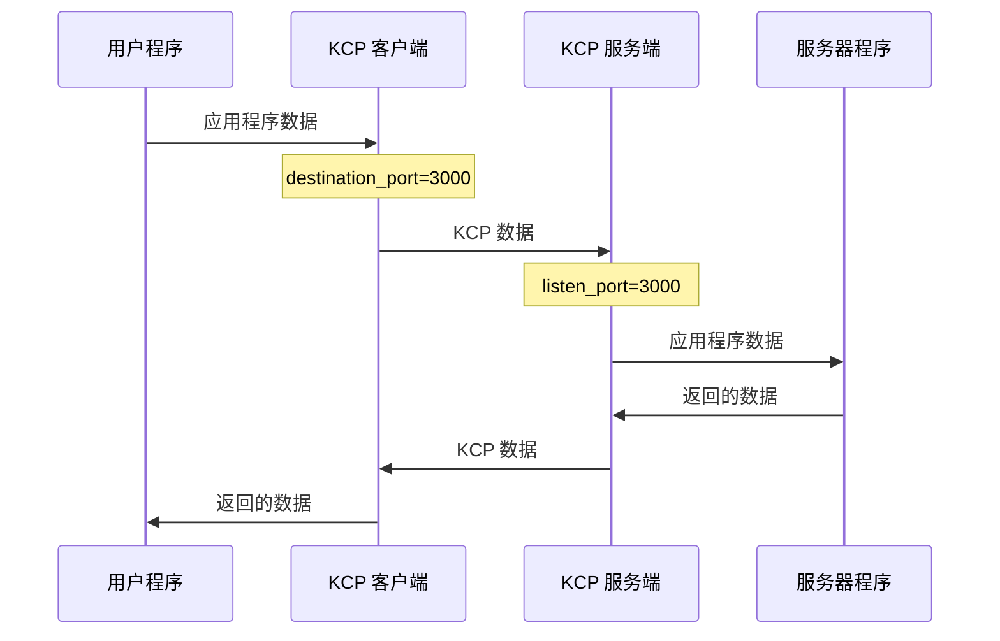

# kcptube.rs 常规配置

本页介绍客户端模式与服务端模式的常见配置写法。示例中的加密口令、IP 地址、端口号请按实际情况修改。仓库 [`service/`](../service/) 目录下附有可直接使用的示例配置（`config_sample_*.conf`、`config_hop_*.conf`）。

两端的 `encryption_algorithm` 与 `encryption_password` 必须完全一致，否则无法解出有效数据。

## 最基础的配置文件

这是最为基础的配置文件，可以按照个人需求修改相应配置。

在这个模式，服务端只提供单个端口连接。但为了尽量躲避 QoS，客户端仍然会尝试每隔 1 分钟就换一次发送端口（除非 dport_refresh 设为 0 主动禁用）。

客户端模式示例：
```
mode=client
kcp=regular3
inbound_bandwidth=500M
outbound_bandwidth=50M
listen_port=59000
destination_port=3000
destination_address=123.45.67.89
encryption_password=qwerty1234
encryption_algorithm=AES-GCM
```

服务端模式示例：
```
mode=server
kcp=regular3
inbound_bandwidth=1G
outbound_bandwidth=1G
listen_port=3000
destination_port=59000
destination_address=::1
encryption_password=qwerty1234
encryption_algorithm=AES-GCM
```

流程：


## 动态端口模式（端口跳跃）

在这个模式，服务端指定一段连续的端口范围，客户端在连接时随机选择其中一个端口号建立连接，随后每隔 1 分钟就换一个端口号。

客户端模式示例：
```
mode=client
kcp=regular3
inbound_bandwidth=500M
outbound_bandwidth=50M
listen_port=6000
destination_port=3000-4000
destination_address=123.45.67.89
dport_refresh=600
encryption_password=qwerty1234
encryption_algorithm=AES-GCM
```

服务端模式示例：
```
mode=server
kcp=regular3
inbound_bandwidth=1G
outbound_bandwidth=1G
listen_port=3000-4000
destination_port=6000
destination_address=::1
encryption_password=qwerty1234
encryption_algorithm=AES-GCM
```

如果想要 5 分钟（即 600 秒）才更换端口，那么可以在客户端配置文件内加上 `dport_refresh=600`。

初次连接时，服务端会向客户端告知自己的 `listen_port` 范围（仅当写成连续范围时），因此客户端的 `destination_port` 必须落在服务端的 `listen_port` 范围内，以免客户端选错端口连接不上。客户端的 `listen_port` 与服务端的 `destination_port` 是另一组相互独立的配置（分别对应本地用户程序的接入端口与服务端回连本地程序的端口），两边可以不一致。

### 端口跳跃的工作方式（Rust 版）

- 客户端每隔 `dport_refresh` 秒从目标端口池中随机挑一个新端口，先用探测包试连；3 秒内收到回应才切换主通道，否则保持原端口继续通讯。
- 切换后，旧端口仍会继续接收数据约 4 秒，以接住在途报文。
- `dport_refresh` 未填写时默认 60 秒；最小 20 秒（填 1 ~ 19 会按 20 秒算）；填 0 表示禁用端口跳跃。
- 服务端的 `listen_port` 写成连续范围时，会把范围告知客户端，客户端据此刷新可跳端口池；写成不连续端口时客户端只能使用自己配置的端口列表。

> 与 C++ 版的差异：端口跳跃的探测时机按数据通道的 `dport_refresh` 周期执行，与 C++ 版（建链时探测）触发点略有不同，不影响互通与转发。

### 监听端口的说明

- 客户端只使用 `listen_port` 列表中的**第一个端口**（与 C++ 版一致）。客户端的端口列表写法主要用于动态端口场景的目标指定。
- 服务端的 `listen_port` 可以写范围，服务端会**逐端口监听**，所有端口共享同一份会话表——这正是端口跳跃能无缝工作的基础。

## 连接建立与重试（Rust 版）

- 客户端对 `destination_address` 中的**每个**解析结果（域名可能同时返回 A/AAAA 记录）依次尝试握手；某个地址不可达时自动换下一个，不会卡在第一个地址上。
- 握手期间底层 UDP 报错（例如对端未监听、或防火墙回 ICMP 端口不可达）只会被忽略并继续重试，不会立即断开本地连接。
- 单次握手超时 30 秒（多地址时按候选数量均分、每个至少 5 秒），超时后换新的本地 UDP 端口重新发起握手；客户端先于服务端启动时，本地连接会等待并自动恢复（mux 模式下排队等待隧道，最长 30 秒）。
- 接收端对数据包时间戳的校验是**双向**的：与本机时间相差不超过 255 秒都会接受，因此两台设备的时钟只需大致同步（同一量级即可），不必精确到秒。

## 使用 STUN 打洞

> **注意**：Rust 版当前尚未实现 STUN 打洞，`stun_server` 可以写入配置并通过 `--check-config` 校验，但运行时不会生效。以下内容说明该功能的配置方法，供将来版本参考。

如果服务端位于 NAT 后方，那么可以在服务器端的配置文件内填入 STUN 服务器地址。

```
mode=server
kcp=regular3
inbound_bandwidth=1G
outbound_bandwidth=1G
listen_port=3000
destination_port=59000
destination_address=::1
encryption_password=qwerty1234
encryption_algorithm=AES-GCM
stun_server=stun.qq.com
log_path=./
```

注意：使用 STUN 打洞时，服务端无法侦听多端口，只能使用单端口模式；不支持自定义侦听地址。因为 STUN 打洞后获得的端口号并不固定，即使服务端自己的端口范围是连续的，打洞时无法保证获得的端口号范围也是连续的。因此这种模式下 KCPTube 限制为只能使用单端口模式。

## 指定侦听网卡

客户端及服务端都可以指定侦听的网卡，只须指定该网卡的 IP 地址。加一行即可

```
listen_on=192.168.1.1
```

或者多个地址

```
listen_on=192.168.1.1,172.16.20.1
```

如果 `listen_on` 未填写，则监听所有可用接口：默认使用 IPv6 通配地址 `[::]` 并开启 IPv4 映射（双栈），IPv4 与 IPv6 客户端都能接入，与 C++ 版一致。若只需要 IPv6，写 `ipv6_only=yes`；若系统禁用了 IPv6，写 `ipv4_only=yes` 可退回 IPv4 单栈。详见[参数列表](parameters.md)。

## 多个目标地址

客户端及中继模式都可以指定多个目标地址，这些地址必须指向同一个服务端。客户端每次建立通道时会**随机挑选**其中一个地址与端口组合。

```
destination_address=127.0.0.1,::1,10.200.30.1
```

**备注**：使用多地址时，建议客户端的 `destination_address` 与服务端的 `listen_on` 保持一致。

如果服务端的 `listen_on` 未填写，那么在填写客户端 `destination_address` 时需要确保每个地址都处于不同的网段。

例如，客户端填写 `destination_address=192.168.0.1,FDCA:1234::1`，那么可以不填写服务端的 `listen_on`，因为 `192.168.0.1`、`FDCA:1234::1` 必然不是同一个网段。

如果客户端填写 `destination_address=192.168.0.1,192.168.0.2,FDCA:1234::1,FDCA:1234::2`，那么最好在服务端的 `listen_on` 那里指定这几个地址，以免数据包从意想不到的地址发出去。

## 不连续端口范围

若需要使用非连续端口范围，可以使用逗号分隔

### 服务端

```
listen_port=13000-13050,14000-14050,15000
```

### 客户端
```
destination_port=13000-13050,14000-14050,15000
```

端口列表会自动去重并升序排列，末尾多余逗号会被容忍。

## 自己指定 KCP 选项

如果想要更细致的设置，可以自己指定 KCP 选项。

客户端模式示例：
```
mode=client
kcp=manual
kcp_mtu=1400
kcp_sndwnd=512
kcp_rcvwnd=2048
kcp_nodelay=1
kcp_interval=10
kcp_resend=2
kcp_nc=true
udp_timeout=300
listen_port=6000
destination_port=3000-4000
destination_address=123.45.67.89
dport_refresh=600
encryption_password=qwerty1234
encryption_algorithm=AES-GCM
```

服务端模式示例：
```
mode=server
kcp=manual
kcp_mtu=1400
kcp_sndwnd=512
kcp_rcvwnd=2048
kcp_nodelay=1
kcp_interval=10
kcp_resend=2
kcp_nc=true
udp_timeout=300
listen_port=3000-4000
destination_port=6000
destination_address=::1
encryption_password=qwerty1234
encryption_algorithm=AES-GCM
```

注意：`kcp=manual` 时 `kcp_nodelay`、`kcp_interval`、`kcp_resend`、`kcp_nc` 四项必须全部填写，缺一不可。使用预设模式（fast / regular）时这些值会被预设覆盖，详见[参数列表](parameters.md)。

## 多路复用通道

如果被承载的程序会产生大量独立连接（例如代理转发程序），可以在**客户端**配置中启用多路复用：

```
mux_tunnels=3
```

服务端不需要（也不允许）配置该参数，会根据客户端的连接方式自动适配。关于多路复用的取舍，详见[参数列表](parameters.md#多路复用-mux_tunnelsn)。

## UDP 会话与保活

- `udp_timeout`：UDP 应用程序 ↔ kcptube 之间的空闲超时（默认 180 秒）。双向空闲超过该时长后 UDP 会话会被回收。
- `keep_alive`：两个 KCP 端之间的保活间隔（默认 0 = 停用）。可单方面启用，用于检测通道是否停止响应。**注意**：任何通道（含 TCP 长连接）空闲超过 255 秒都会被强制关闭，长时间无流量的连接请配置 `keep_alive`。

## 多个配置文件

如果想要侦听多个端口、多个网卡，那就分开多个配置文件，然后同时使用

```
kcptube config1.conf config2.conf
```

每个配置文件独立解析、并发启动（与 C++ 版一致），客户端 / 服务端 / 中继模式可同时运行。任意一个配置文件有错误时，程序不会启动任何模式。
