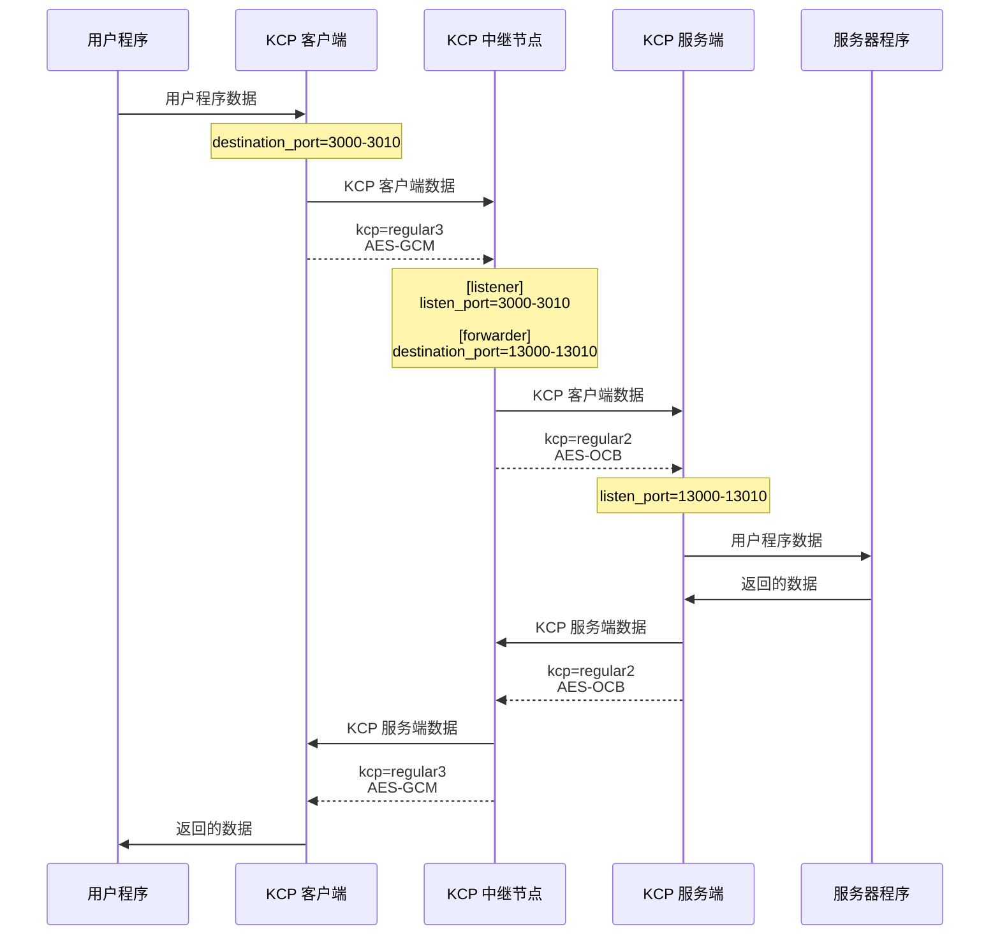

# kcptube.rs 中继模式配置

> **注意**：Rust 版当前**尚未实现中继模式的运行期**（计划在后续版本补齐）。配置文件可以正常解析与校验（`--check-config` 可用于检查中继配置是否正确），但实际启动会提示中继模式尚未实现。本页介绍配置写法与规则，供配置校验与将来版本使用；现阶段需要中转请暂用 C++ 版。

中继模式用于无公网 IP 的场景：客户端连到中继节点（入口），中继节点再转发给服务端（出口）。

中继节点由两部分组成，配置中必须明确写出两个节点标签——`[listener]` 与 `[forwarder]`，不可忽略：

- `[listener]`（入口）：与客户端交互数据，配置写法类似服务端模式；
- `[forwarder]`（出口）：与服务端交互数据，配置写法类似客户端模式。

## 配置文件示例

客户端模式示例：
```
mode=client
kcp=regular3
inbound_bandwidth=500M
outbound_bandwidth=50M
listen_port=59000
destination_port=3000-3010
destination_address=123.45.67.89
encryption_password=qwerty1234
encryption_algorithm=AES-GCM
```

中继模式示例：
```
mode=relay

[listener]
kcp=regular3
inbound_bandwidth=300M
outbound_bandwidth=300M
listen_port=3000-3010
encryption_password=qwerty1234
encryption_algorithm=AES-GCM

[forwarder]
kcp=regular2
inbound_bandwidth=300M
outbound_bandwidth=300M
destination_port=13000-13010
destination_address=87.65.43.21
encryption_password=qwerty1234
encryption_algorithm=AES-OCB
udp_timeout=10
```

服务端模式示例：
```
mode=server
kcp=regular2
inbound_bandwidth=1G
outbound_bandwidth=1G
listen_port=13000-13010
destination_port=59000
destination_address=::1
encryption_password=qwerty1234
encryption_algorithm=AES-OCB
```

留意看的话可以发现，客户端、服务端的 KCP 设置和加密选项都不一样。

没错，只需要正确配置中转站两侧各自的通道即可，中继节点在转发时会重新加密。

除此之外，即使一侧通道使用动态端口，另一侧不使用动态端口，也是可以的。

流程：


## 配置文件可共用选项

以下配置选项可以写在 `[listener]`、`[forwarder]` 标签外（根部），用于一次性配置两侧：

- mtu
- fec
- kcp
- kcp_rcvwnd
- kcp_sndwnd
- outbound_bandwidth
- inbound_bandwidth
- encryption_password
- encryption_algorithm
- udp_timeout
- keep_alive
- ipv4_only / ipv6_only
- blast
- update_ipv4 / update_ipv6
- fib_ingress / fib_egress

若出现在节点标签外，就会覆盖所有节点标签内的对应值（前提是在根部**显式写过**该配置项；未写的项不会覆盖段内取值）。

例外与细节：

- `blast` 的默认值就是开启，因此根部不写 `blast` 时也会覆盖段内——**`blast=no` 只能写在段外**，写在段内无效（这是与 C++ 版一致的行为）。
- `encryption_algorithm` 写 `none` 或不写时不会覆盖段内；`encryption_password` 为空时不会覆盖段内。
- `ipv4_only` / `ipv6_only` 只要在根部出现过（无论取值），就会覆盖段内。只想让某一段生效时，请把它写在段内。
- **不会**被根部覆盖的有：`dport_refresh`、`mux_tunnels`、`stun_server`、`log_path`、`listen_on` / `listen_port`、`destination_address` / `destination_port`，以及 `kcp_mtu`、`kcp_nodelay`、`kcp_interval`、`kcp_resend`、`kcp_nc`。这些需要写在各自的段内。

例如，可以这样写：
```
mode=relay
kcp=fast4
outbound_bandwidth=300M
inbound_bandwidth=300M
encryption_password=qwerty1234
encryption_algorithm=AES-GCM

[listener]
listen_port=3000-3010

[forwarder]
destination_port=13000-13010
destination_address=127.0.0.1
```

如果整条链路的 KCP 设置都一样，这样做确实可以方便不少。

## 注意事项

- 若需要自行配置 `udp_timeout`，请确保中继节点的 `udp_timeout` 应当大于等于服务端与客户端的 `udp_timeout` 值，以免过早清理转发链路。（Rust 版解析配置时会自动给中继两个段的 `udp_timeout` 各加 5 秒余量，与 C++ 版一致。）
- `mux_tunnels` 不允许在中继模式设置（会报 `mux_tunnels should not be set`）。
- `[listener]` 段必须配置 `listen_port`；`[forwarder]` 段必须配置 `destination_address` 与 `destination_port`。缺少任一段或任一必填项，`--check-config` 都会报错。
